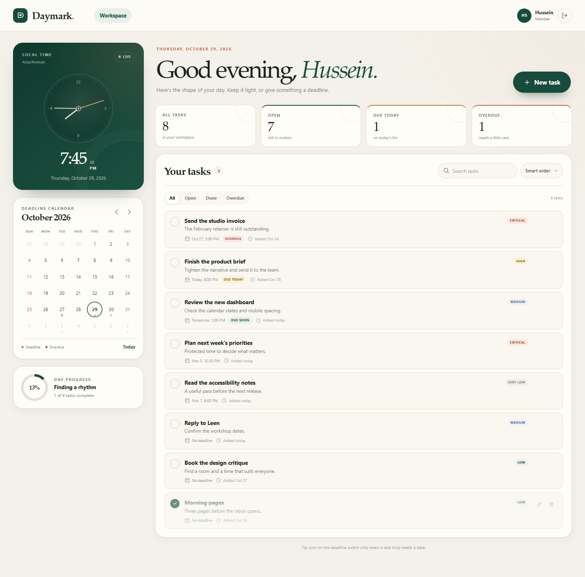
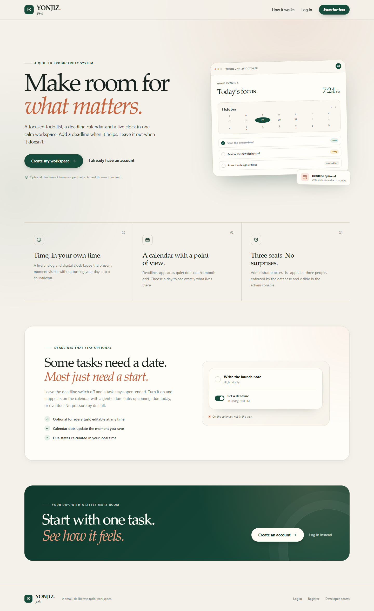
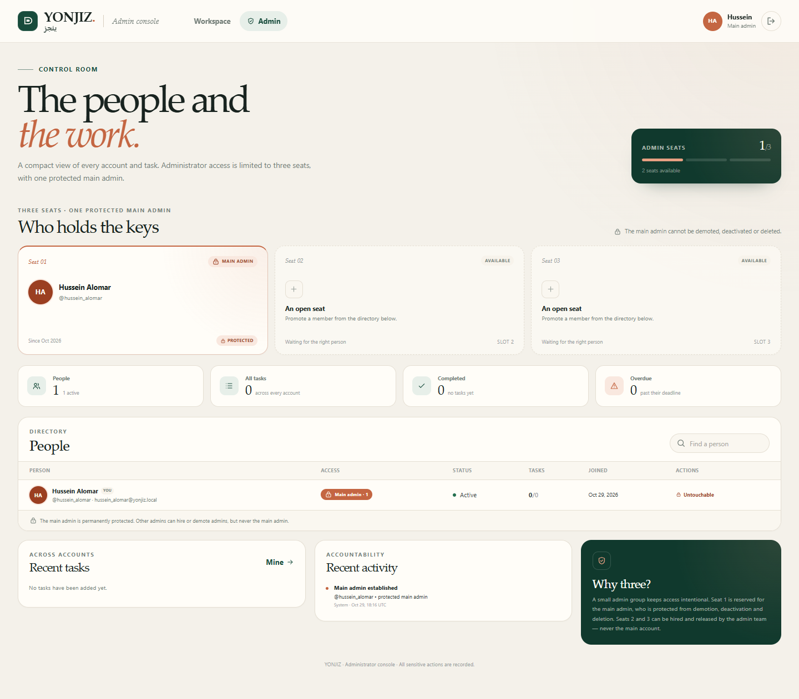
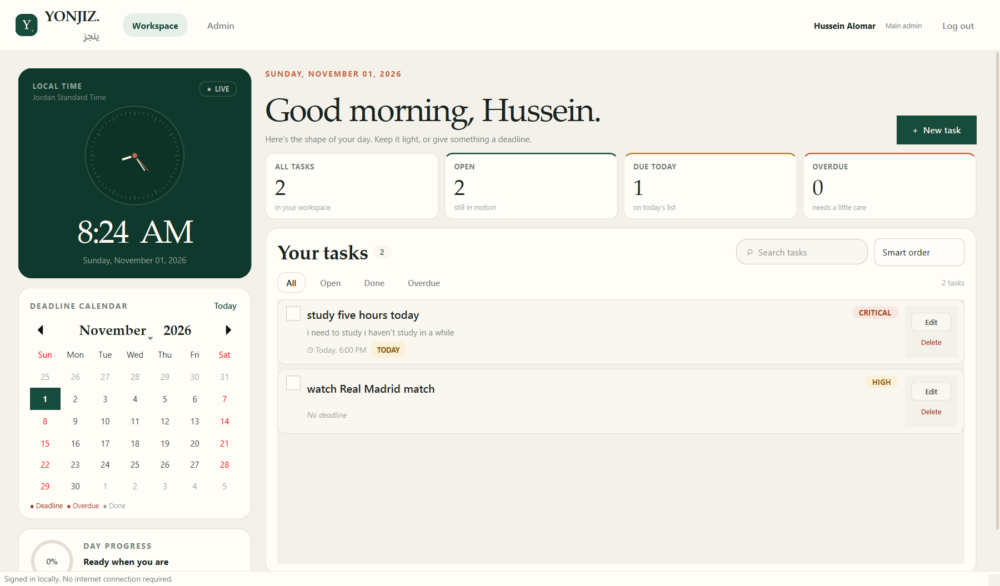
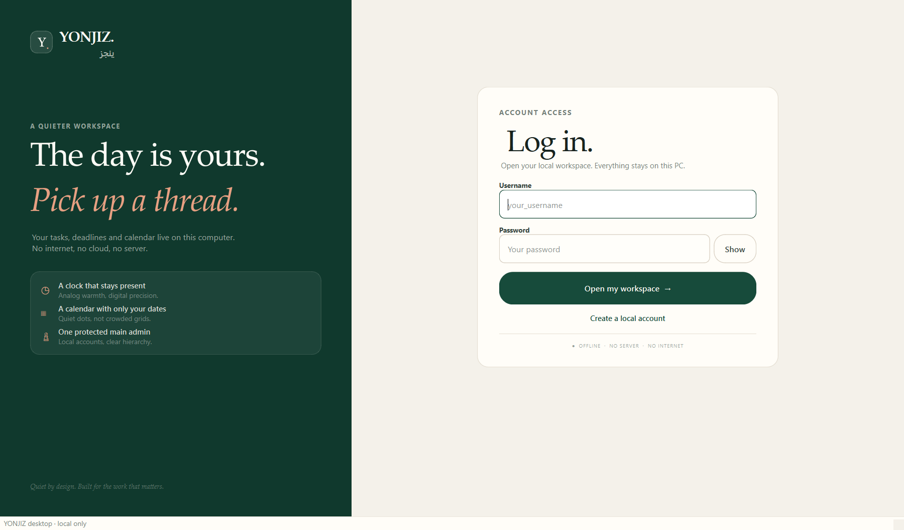
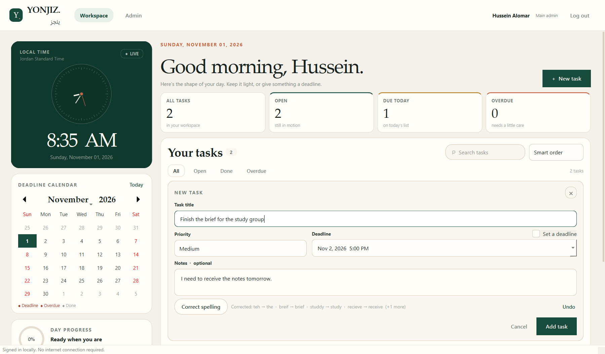
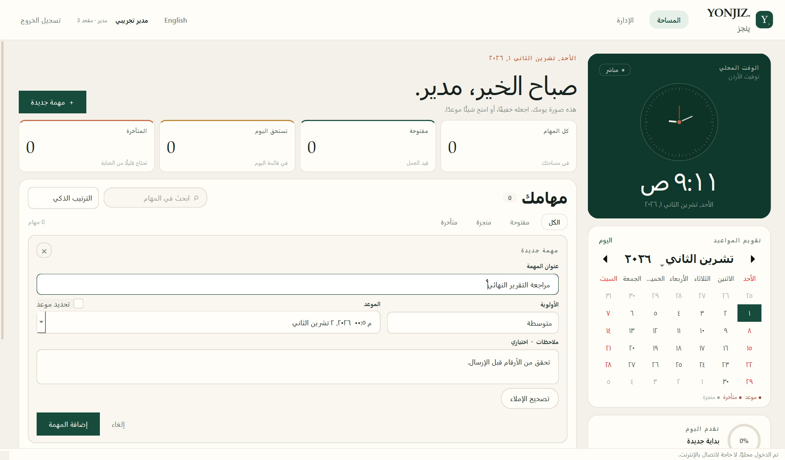
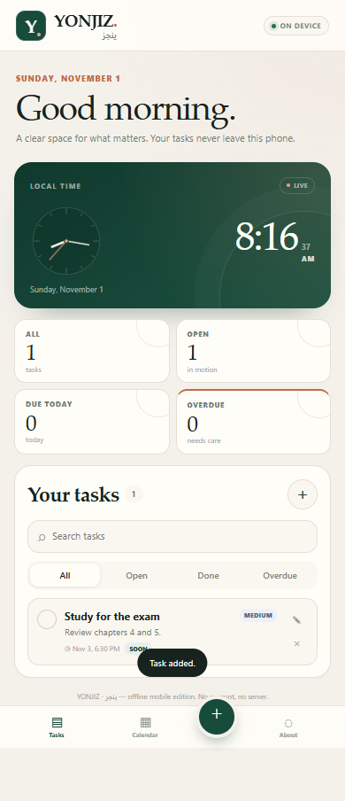

# YONJIZ · ينجز

A bilingual (English / Arabic) task management app built on a FastAPI REST API, with a live clock, a deadline calendar, optional task deadlines, and a three-seat administrator console with one protected main admin. It ships as a web app, an offline Windows desktop app and an Android app.

**Tech stack:** Python, FastAPI, SQLAlchemy, Pydantic, Jinja2, SQLite (PostgreSQL supported), JWT cookie authentication, Qt (desktop), PyInstaller, pytest.



## What you get

- **A real UI** — landing page, split-screen auth pages, responsive workspace, designed empty states, accessible dialog, toasts and keyboard focus states.
- **Live clock** — analog and digital, browser-local timezone, no database dependency.
- **Deadline calendar** — a month grid with deadline and overdue dots. Click a day to filter the task list. Collapsible on phones.
- **Optional deadlines** — a switch in every task dialog. Off means `deadline IS NULL`; the task stays entirely open-ended. Editable at any time.
- **Admin console** — metrics, user directory, promote/demote, activate/deactivate, delete account (with task cascade), delete tasks, recent activity and a visual three-seat meter.
- **Protected main admin** — seat 1 belongs to one permanent main admin. No other admin can demote, deactivate or delete that account. The main admin can hire and release other admins.
- **Hard three-admin limit** — each admin takes a unique seat from 1–3. A database `UNIQUE` constraint plus a `CHECK` constraint makes a fourth admin impossible, even through direct SQL.
- **Developer door** — `/admin/access` + a server-side key promotes your signed-in account without creating a second login. A CLI command is available too.
- **Auditability** — sensitive admin actions are recorded in `admin_audit`.
- **No external UI dependencies** — no CDN, no build step, no JavaScript framework. The CSP allows only same-origin assets.

| Landing | Admin console |
| --- | --- |
|  |  |

## Native desktop app (offline)



The desktop edition is a **native Qt application**, not a browser wrapper:

- Click **YONJIZ** on the Windows Desktop, or run:
  ```text
  %LOCALAPPDATA%\Programs\YONJIZ\YONJIZ.exe
  ```
- No FastAPI, Uvicorn, localhost port, browser, or internet connection is used.
  The UI talks directly to SQLite in the same process.
- The database lives in `%LOCALAPPDATA%\YONJIZ\todo.db`.
- The first launch seeds that folder with the current workspace (accounts and tasks).
- The app includes the login screen, live analog clock, deadline calendar, task
  CRUD, filters, local account creation, the three-seat admin console and the
  protected main admin.
- Login is the first page of the same main window. It never opens a second
  window or a browser.
- Task creation and editing happen in an **inline composer inside the task
  panel** — no task dialog window.
- A completely local English **spelling correction** button checks the task
  title and notes, with an Undo action. It uses a bundled dictionary and never
  calls the internet.
- Larger, high-DPI-friendly typography and a **Show / Hide password** control on
  both login and local account creation.
- **English / العربية** language switch on both the login page and the workspace
  top bar, with RTL layout, localized dates and a saved preference.
- Keyboard shortcuts: `Ctrl+N` new task, `Ctrl+K` search, `Ctrl+1` workspace,
  `Ctrl+2` admin console, `Ctrl+L` log out.
- Minimum window size is 1160×780; it opens at 1440×940.

The installer seeds the local database from the `seed` folder on first launch.

| Sign in | Password visible |
| --- | --- |
|  |  |



| English | العربية |
| --- | --- |
|  |  |

### Rebuild the desktop app

```powershell
python -m venv .venv-desktop
.\.venv-desktop\Scripts\python.exe -m pip install -r desktop\requirements-desktop.txt
.\build_desktop.ps1
```

`build_desktop.ps1` backs up the current database into `seed\todo.db`, builds
`dist\YONJIZ\YONJIZ.exe`, smoke-tests the package, installs it under
`%LOCALAPPDATA%\Programs\YONJIZ`, and recreates the `YONJIZ.lnk` Desktop shortcut.

> The desktop database is intentionally separate from the web app's `todo.db`.
> It is seeded at build time and then evolves locally, so the app never needs a
> server to run.

## Android mobile app (offline)



The Android build script below produces an installable `YONJIZ.apk`.

It is a standalone WebView shell around local HTML/CSS/JS with data stored in a
private JSON file. The manifest has **no INTERNET permission**; there is no
server, no backend, and no network call. Features include:

- task list with optional deadlines, notes, priorities and completion;
- live analog/digital clock;
- month calendar with deadline dots and day filtering;
- search and fast filters;
- local-only persistence.

It does not share data with the desktop or web editions. See
[mobile/README.md](mobile/README.md) for installation and rebuild steps.

### Rebuild the APK

```powershell
.\mobile\build_android.ps1
```

## Web edition (optional)

The desktop app is the recommended way to use YONJIZ. This web edition remains
for browser use and for reference; it needs a local FastAPI process.

Requires Python 3.11+ (verified on 3.13 and 3.14).

```powershell
python -m venv .venv
.\.venv\Scripts\Activate.ps1
pip install -r requirements.txt

# Create the protected main admin on a fresh database
python manage.py create-main-admin

# Optional: add a demo user with sample tasks
python manage.py seed-demo

uvicorn main:app --reload
```

Open <http://127.0.0.1:8000>.

The first run creates a local SQLite database (`todo.db`), a persistent JWT secret (`.secret_key`) and a developer key (`.admin_access_key`). These files are git-ignored. In production, set `SECRET_KEY` and `ADMIN_ACCESS_KEY` as environment variables instead.

### Demo login (only if you ran `seed-demo`)

```text
username: demo
password: Demo1234!
```

### Create the protected main admin

On a fresh database:

```powershell
python manage.py create-main-admin
```

The command prompts for the username, email, name and password, or accepts the corresponding flags. Only one main admin can exist, and it always occupies seat 1. After signing in, the main admin can hire admins from the console.

The developer door still exists:

```powershell
python manage.py show-key
# Sign in, open /admin/access, paste the key.
```

The admin link appears in the top navigation only after the account has the `admin` role. All routes obey the three-seat limit.

## The three-admin rule

The limit is enforced in the database, not only in the UI:

```sql
admin_slot INTEGER,                         -- NULL for regular users
CONSTRAINT uq_users_admin_slot UNIQUE (admin_slot),
CONSTRAINT ck_users_admin_slot CHECK (
    (role = 'admin' AND admin_slot IS NOT NULL AND admin_slot BETWEEN 1 AND 3)
    OR
    (role = 'user' AND admin_slot IS NULL)
)
```

That means:

- At most three rows can have a non-null `admin_slot`.
- An admin cannot accidentally exist without a seat.
- A fourth admin is rejected by both the application and the database.
- A demoted admin releases their seat immediately.
- Admins cannot demote, deactivate or delete themselves, and the last admin cannot be removed.

### The protected main admin

Seat 1 is reserved for the single main admin (`is_primary_admin = 1`). This account is created through `manage.py create-main-admin` or the permanent bootstrap account.

- No other admin can demote, deactivate or delete it.
- The main admin can promote regular users to admin and demote other admins.
- The UI shows **Main admin**, **Protected** and **Untouchable** instead of action buttons for that row.
- Even if another admin is looking at the directory, the account has no demote/deactivate/delete controls.
- A database `CHECK` keeps the main admin in seat 1 and active; a unique partial index allows only one main admin.
- The three-seat cap still applies: seat 1 is the main admin, seats 2–3 are hireable.

The admin console displays the three seats, occupied or available, and disables promotion when all seats are used. See [docs/ER_DIAGRAM.md](docs/ER_DIAGRAM.md) for the full rationale and SQL.

## Configuration

Copy `.env.example` to `.env` if you want to override the defaults.

| Variable | Default | Purpose |
| --- | --- | --- |
| `DATABASE_URL` | SQLite `todo.db` | Use `postgresql+psycopg://...` for PostgreSQL (install `psycopg[binary]`). |
| `SECRET_KEY` | generated `.secret_key` | JWT signing key. Set explicitly in production. |
| `ADMIN_ACCESS_KEY` | generated `.admin_access_key` | Key for `/admin/access`. |
| `DEVELOPER_EMAIL` | unset | Optional: restrict developer access to one account. |
| `ACCESS_TOKEN_EXPIRE_MINUTES` | `480` | Session cookie lifetime. |
| `COOKIE_SECURE` | `false` | Set `true` behind HTTPS. |
| `APP_NAME` | `YONJIZ` | English brand name shown in templates. |
| `APP_NAME_AR` | `ينجز` | Arabic brand name shown beneath the English name. |

Deadline timestamps are stored as naive UTC, then formatted in the user's local timezone by the browser. Calendar day filtering also uses the local timezone, so a deadline late in the day does not drift across days for the user.

## Tests

```powershell
python -m pytest -q
```

The suite covers registration/login, password hashing, inactive accounts, owner-scoped todo CRUD, optional deadlines, developer access, admin self-protection, main-admin protection, hiring/kicking admins, account/task cascades, audit entries, and the three-admin constraint at both the route and database layers.

## Project layout

```text
desktop_app.py           native Qt entry point; no server, no network
desktop/service.py       direct SQLite task/admin service
desktop/pages.py         login, workspace and admin pages
desktop/widgets.py       clock, task cards, inline composer, dialogs
desktop/spellcheck.py    offline bundled English spelling corrector
desktop/i18n.py          English/Arabic translations and locale helpers
desktop/assets/          app icon and brand mark
build_desktop.ps1        package/install/create Desktop shortcut
YONJIZ.spec              PyInstaller build definition
mobile/                  standalone Android project (WebView + local files)
mobile/app/src/main/assets/  mobile HTML/CSS/JS, no network
mobile/build_android.ps1 build APK and copy it to the Desktop
docs/screenshots/mobile-*.png
main.py                  FastAPI app, security headers, error pages
config.py                env/config and generated local secrets
database.py              engine, session, SQLite pragmas
models.py                User, Todo, AdminAudit + seat and main-admin constraints
schemas.py               Pydantic payloads and UTC serialization
security.py              bcrypt hashing + JWT
dependencies.py          current-user / optional-user / admin guards
admin_service.py         seat allocation and audited admin actions
manage.py                create-main-admin, create-admin, list-admins, show-key, seed-demo
routers/
  auth.py                register, login, logout
  todos.py               workspace page + owner-scoped JSON API
  admin.py               admin console + developer access
templates/               Jinja pages and the task-card partial
static/css/app.css       visual system and responsive layout
static/js/clock.js       analog + digital clock
static/js/calendar.js    month grid, deadline dots, date selection
static/js/dashboard.js   filters, dialog, CRUD, stats, due states
static/js/admin.js       directory search
docs/ER_DIAGRAM.md       ER explanation, edits, queries, migration notes
docs/schema.sql          SQLite schema
docs/postgres_schema.sql PostgreSQL schema
docs/migrate_existing_postgres.sql  migration for an older database
docs/er_diagram.svg/.png rendered ER diagram
tests/                   pytest suite
```

## Routes

| Route | Access | Description |
| --- | --- | --- |
| `/` | Public | Landing page |
| `/auth/register-page` | Public | Account creation (always creates a regular user) |
| `/auth/login-page` | Public | Login |
| `/auth/token` | Public | JSON bearer token for API clients |
| `/todos` | Signed in | Workspace |
| `/api/todos` | Signed in | Create/list-own task API |
| `/api/todos/{id}` | Owner | Update/delete own task |
| `/api/todos/{id}/complete` | Owner | Toggle completion |
| `/admin` | Admin | Admin console |
| `/admin/access` | Signed in | Developer key gate |
| `/healthy` | Public | Health check |

## Security notes

- Role is loaded from the database on every request. Demotion takes effect immediately, even with an unexpired token.
- The main admin account is protected in the admin service, not only by hidden buttons. Direct requests are rejected too.
- Passwords are hashed with bcrypt (cost 12); the application never stores plaintext.
- `registration` ignores any posted role field, so self-promotion is impossible.
- All task queries are scoped to the owner; a different signed-in user receives 404 for someone else's task.
- Forms and fetches are same-origin; the session cookie is `HttpOnly` and `SameSite=Lax`. Set `COOKIE_SECURE=true` and serve over HTTPS in production.
- Security headers include a strict same-origin CSP, `X-Frame-Options: DENY`, `nosniff`, a referrer policy and a restrictive permissions policy.
- Developer key attempts are rate-limited in-process. For a multi-worker deployment, move the limiter to Redis or put the gate behind your auth proxy.

## Migrating from the original app

The attached project used PostgreSQL with a `users`/`todos` schema that did not match its models. To move that data:

1. Back up the database.
2. Read [docs/migrate_existing_postgres.sql](docs/migrate_existing_postgres.sql).
3. Resolve any existing admin accounts before running the script (it deliberately refuses to guess if there are already more than three).
4. Set `DATABASE_URL` and install `psycopg[binary]`.
5. Run the migration in a staging copy first, then start the app and sign in with the existing password.

For SQLite, start with a fresh `todo.db`. See [docs/ER_DIAGRAM.md](docs/ER_DIAGRAM.md#migration-notes) for the details.

## Design notes

The interface uses a warm paper palette, a deep forest surface, Palatino-style display type and terracotta accents. It is intentionally quiet: no third-party fonts, no animation for its own sake, and a calendar that shows only the dates that are actually yours. All screens are responsive, with a compact clock and a collapsible calendar on phones.

If you want to change the look, start with the custom properties at the top of `static/css/app.css`.
