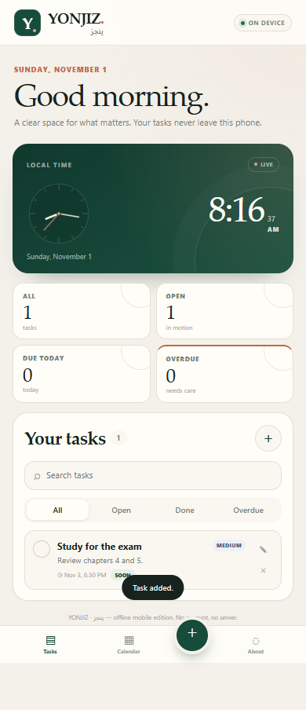

# YONJIZ Mobile

A standalone offline Android app built as a native WebView shell around local
HTML/CSS/JS. It has **no server, no backend, no network calls and no INTERNET
permission**.



## Features

- Daily task list with optional deadlines, priorities, notes and completion.
- Live analog + digital clock.
- Month calendar with deadline projections; tap a day to filter.
- Search, fast filters, local timezone handling.
- Task data persisted as a private JSON file inside the app sandbox.
- No accounts, no telemetry, no remote sync.
- Android back button closes the sheet or returns to Tasks first.

## Install on a phone

1. Copy `YONJIZ.apk` from the Windows Desktop to the phone.
2. Open the APK on the phone.
3. Allow installs from that source when Android asks.
4. Launch **YONJIZ**.

Minimum Android: 6.0 (API 23). Target: Android 14 (API 34).

## Data

The app stores data in:

```text
/data/data/com.yonjiz.app/files/yonjiz-mobile.json
```

Uninstalling the app removes that file. The phone app has its own local data and
does **not** share data with the desktop or web editions.

## Build

Requirements:

- JDK 17
- Android SDK with platform 34 and build-tools 34
- Gradle 8.3 (the local Gradle wrapper cache is used by the build script)

```powershell
cd "C:\Users\husse\Desktop\todo_app"
.\mobile\build_android.ps1
```

The script builds a debug APK at:

```text
mobile\app\build\outputs\apk\debug\app-debug.apk
```

and copies it to `C:\Users\husse\Desktop\YONJIZ.apk`.

## Security / permissions

The manifest intentionally contains only the launcher activity and **no**
`android.permission.INTERNET`. WebView is limited to local `file:///android_asset`
content. The JSON storage bridge writes only inside the app's private files
directory. The app can therefore operate fully offline.
